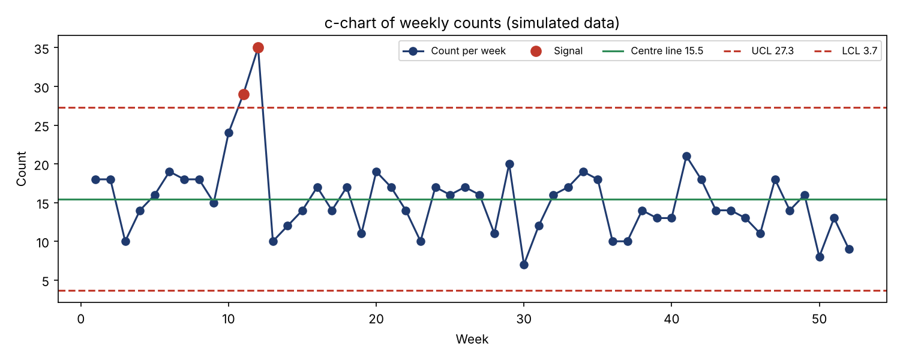

# c-chart example (simulated data)

`c_chart.py` simulates 52 weeks of counts with a short burst of extra failures, then draws the centre line (average count) and the control limits (centre ± 3 × √centre). Points outside the limits are flagged as signals. The data are simulated: no company data is used.
